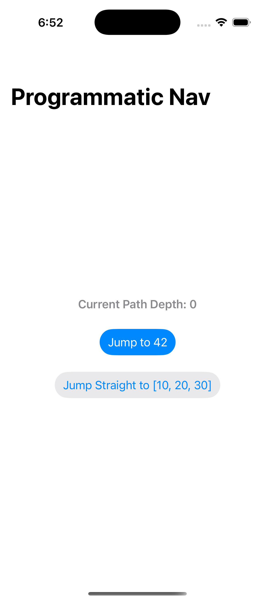

# Lesson 3: Programmatic Navigation with NavigationStack

In this lesson from Paul Hudson's **100 Days of SwiftUI** (Day 44 / Project 9), we learn how to control the navigation stack directly with code by binding a path array to `NavigationStack(path: $path)`.

---

## 📱 Screenshot

<p align="center">
  
</p>

---

## 🧭 Key Concepts

1. **Path as an Array:** The navigation backstack is treated as a standard Swift Array (e.g. `[Int]`).
2. **Pushing via Code:** Adding views is as simple as appending to the array:
   ```swift
   path.append(42)
   ```
3. **Multi-screen Jump:** You can jump multiple screens deep at once:
   ```swift
   path = [10, 20, 30]
   ```
4. **Pop to Root:** Returning all the way back to the root view in a single line:
   ```swift
   path.removeAll()
   ```
