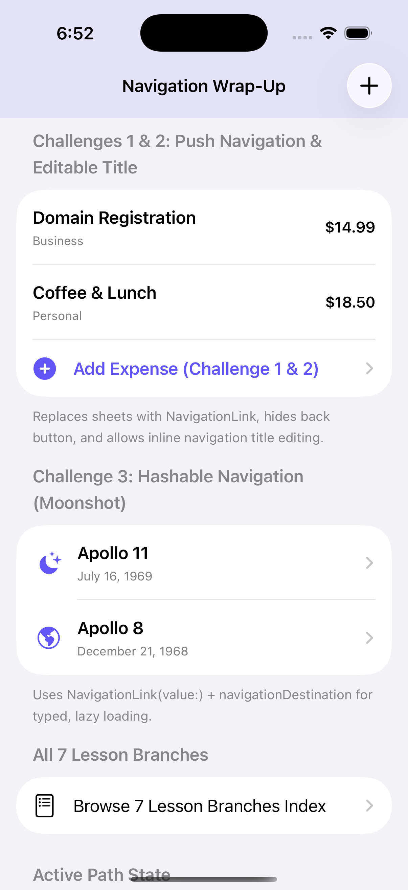

# SwiftUI Navigation: Architecture, Techniques & Wrap-Up Challenge

A comprehensive reference implementation of modern SwiftUI navigation patterns based on Paul Hudson's *100 Days of SwiftUI* (Days 43–46).

This repository contains dedicated branches for each core navigation lesson, with the `main` branch delivering an integrated solution to the **Navigation Wrap-Up Challenge**.



---

## 🚀 Navigation Wrap-Up Challenge Solutions

The `main` branch combines the techniques taught across the course into a unified, interactive application addressing all three wrap-up challenges:

### 1. Challenge 1: Push-Based Navigation over Modal Sheets
* **Problem:** In earlier projects (like *iExpense*), modal sheets were used for adding new records. The challenge asks to replace modal sheets with push navigation while maintaining deliberate save/cancel user control.
* **Solution:** 
  - Navigates via typed route: `NavigationLink(value: NavigationRoute.addExpense)`.
  - Hides the system back button using `.navigationBarBackButtonHidden(true)` so the user cannot accidentally swipe or tap back without making an explicit choice.
  - Adds dedicated toolbar buttons placed at `.cancellationAction` (Cancel) and `.confirmationAction` (Save) that call `@Environment(\.dismiss) var dismiss`.

### 2. Challenge 2: Editable Navigation Title
* **Problem:** Instead of using an extra TextField inside the form to name an item, make the title editable directly in the navigation bar.
* **Solution:**
  - Passes a two-way string binding to `.navigationTitle($expenseName)` combined with `.navigationBarTitleDisplayMode(.inline)`.
  - In iOS 16+, tapping the navigation bar title automatically turns it into an inline editable text field.

### 3. Challenge 3: Decoupled Value-Based Destinations (Moonshot Style)
* **Problem:** Direct view instantiations in `NavigationLink("...", destination: View())` cause eager loading and tight coupling.
* **Solution:**
  - `MissionItem` and `CrewMemberItem` conform to `Hashable` and `Identifiable`.
  - Parent list emits `NavigationLink(value: mission)` and detail view emits `NavigationLink(value: crewMember)`.
  - Views are resolved lazily at the stack root via:
    ```swift
    .navigationDestination(for: MissionItem.self) { mission in
        MissionDetailDestinationView(mission: mission)
    }
    .navigationDestination(for: CrewMemberItem.self) { crewMember in
        CrewDetailDestinationView(crewMember: crewMember)
    }
    ```

### 4. Persistent State Restoration with `Codable`
* Manages the backstack through an observable `PathStore`.
* Automatically serializes `NavigationPath.CodableRepresentation` to JSON in `URL.documentsDirectory` on change.
* On app reboot, the exact navigation depth and visited screens are restored seamlessly.

---

## 📚 Lesson Branches Directory

Every single lesson from the *SwiftUI Navigation* curriculum is isolated on its own Git branch with working code, explanatory notes, and a simulator screenshot:

| Branch Name | Lesson Topic | Core Concept |
| :--- | :--- | :--- |
| [`lesson-01-simple-navigationlink-problem`](#lesson-01) | Simple `NavigationLink` eager loading | Direct view passing causes eager instantiation of 100+ views on initial load. |
| [`lesson-02-navigation-destination`](#lesson-02) | `navigationDestination(for:)` | Decouples data from views; uses `Hashable` for lazy loading on tap. |
| [`lesson-03-programmatic-navigation`](#lesson-03) | Programmatic Navigation with `[Int]` | Binds a homogeneous array path to `NavigationStack`, enabling deep-linking and pop-to-root. |
| [`lesson-04-navigation-path`](#lesson-04) | Heterogeneous `NavigationPath` | Uses type-erased `NavigationPath` to navigate across different types (`Int`, `String`, etc.) in one stack. |
| [`lesson-05-codable-navigation-path`](#lesson-05) | Saving & Restoring `NavigationPath` | Serializes `NavigationPath.CodableRepresentation` to JSON disk storage for app state restoration. |
| [`lesson-06-customizing-navigation-bar`](#lesson-06) | Navigation Bar Styling | `.toolbarBackground`, `.toolbarColorScheme`, display modes, and `.navigationBarBackButtonHidden`. |
| [`lesson-07-editable-title-and-toolbars`](#lesson-07) | Editable Titles & Toolbar Items | Two-way binding `.navigationTitle($title)` and exact placement with `ToolbarItem` & `ToolbarItemGroup`. |

---

## 🛠️ Switching Between Lesson Branches

To explore and test any individual lesson, check out its branch:

```bash
# Lesson 1: Eager loading issue
git checkout lesson-01-simple-navigationlink-problem

# Lesson 2: Lazy destination views
git checkout lesson-02-navigation-destination

# Lesson 3: Programmatic navigation with array
git checkout lesson-03-programmatic-navigation

# Lesson 4: Multi-type NavigationPath
git checkout lesson-04-navigation-path

# Lesson 5: State persistence with Codable
git checkout lesson-05-codable-navigation-path

# Lesson 6: Nav bar appearance customization
git checkout lesson-06-customizing-navigation-bar

# Lesson 7: Inline editable titles and toolbars
git checkout lesson-07-editable-title-and-toolbars

# Return to Main Challenge Hub
git checkout main
```

---

## 📱 How to Build and Run

1. Open `Navigation.xcodeproj` in Xcode 16+.
2. Select an iOS 17+ Simulator (e.g. iPhone 17 Pro).
3. Press `Cmd + R` to run.

Or compile and install directly via terminal:
```bash
DEVELOPER_DIR=/Applications/Xcode.app/Contents/Developer \
xcodebuild -project Navigation.xcodeproj \
-scheme Navigation \
-destination 'generic/platform=iOS Simulator' build
```
