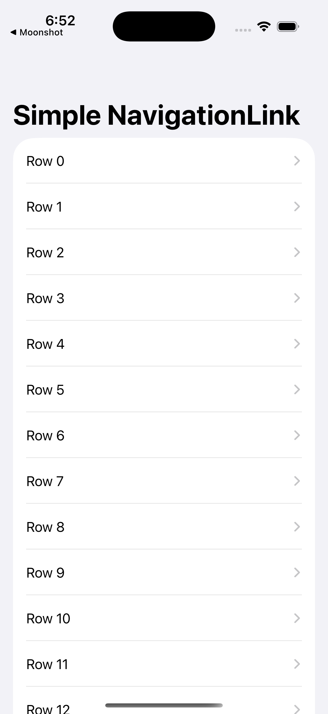

# Lesson 1: The Problem with a Simple NavigationLink

In this lesson from Paul Hudson's **100 Days of SwiftUI** (Day 43 / Project 9), we explore why the classic syntax `NavigationLink("Title", destination: View())` has a major performance flaw.

---

## 📱 Screenshot

<p align="center">
  
</p>

---

## ⚠️ The Problem: Eager Loading

When using the simple initializer:
```swift
List(0..<1000) { i in
    NavigationLink("Row \(i)") {
        DetailView(number: i)
    }
}
```

SwiftUI initializes **every single `DetailView` immediately** when the `List` loads—even before the user taps a row!

If your detail view performs network calls, loads images, or has non-trivial setup in `init()`, this causes severe performance bottlenecks, battery drain, and memory spikes.

---

## 💻 Code Example

See [Navigation/ContentView.swift](file:///Users/remitbee/Documents/iOS/Navigation/Navigation/ContentView.swift):
```swift
struct DetailView: View {
    var number: Int

    init(number: Int) {
        self.number = number
        print("DetailView \(number) initialized immediately!")
    }

    var body: some View {
        Text("Detail View \(number)")
    }
}
```

Check your Xcode console when running this branch: all rows print immediately on launch.
