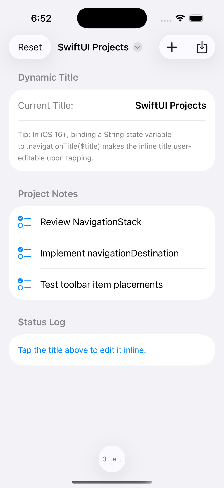

# Lesson 7: Editable Navigation Titles and Toolbar Placements

## Overview
This lesson demonstrates two major SwiftUI navigation capabilities:
1. Making navigation titles dynamically user-editable in-place using two-way state bindings (`.navigationTitle($title)`).
2. Placing and organizing toolbar items across the navigation bar using `ToolbarItem` and `ToolbarItemGroup` with explicit `ToolbarItemPlacement`.



---

## Key Concepts Covered

### 1. Two-Way Binding for Editable Navigation Titles
In iOS 16 and later, passing a `Binding<String>` into `.navigationTitle()` allows users to tap on the title when in `.inline` display mode to edit it directly:
```swift
@State private var title = "SwiftUI Projects"

.navigationTitle($title)
.navigationBarTitleDisplayMode(.inline)
```

### 2. Precise Toolbar Item Placements
The `.toolbar` modifier combined with `ToolbarItem` and `ToolbarItemGroup` gives explicit layout control:

```swift
.toolbar {
    // Leading navigation item
    ToolbarItem(placement: .topBarLeading) {
        Button("Reset") {
            title = "SwiftUI Projects"
        }
    }

    // Trailing item group for action buttons
    ToolbarItemGroup(placement: .topBarTrailing) {
        Button(action: addNote) {
            Label("Add", systemImage: "plus")
        }
        Button(action: save) {
            Label("Save", systemImage: "square.and.arrow.down")
        }
    }

    // Secondary bottom bar placement
    ToolbarItem(placement: .bottomBar) {
        Text("Status text")
    }
}
```

### Semantic Placements vs Physical Placements
- `.topBarLeading` / `.topBarTrailing`: Explicit top bar positions.
- `.confirmationAction` / `.cancellationAction`: Semantic placements that adapt to the target platform guidelines (e.g. bolded Save on iOS trailing, Done on macOS, etc.).
- `.bottomBar`: Displays items at the bottom toolbar region of the screen.

---

## How to Run
Open `Navigation.xcodeproj` in Xcode or run:
```bash
DEVELOPER_DIR=/Applications/Xcode.app/Contents/Developer xcodebuild -project Navigation.xcodeproj -scheme Navigation -destination 'generic/platform=iOS Simulator' build
```
