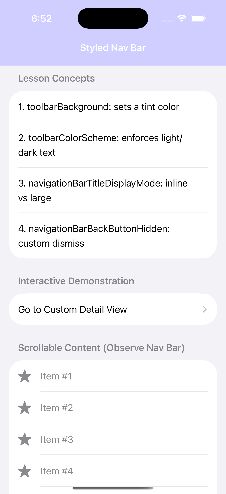

# Lesson 6: Customizing the Navigation Bar Appearance

## Overview
SwiftUI provides fine-grained control over the appearance of the top navigation bar, including background tints, foreground color schemes, display modes, and back button visibility.



---

## Key Concepts Covered

### 1. Tinting the Bar with `.toolbarBackground`
By default, SwiftUI adapts the navigation bar background when content scrolls beneath it. You can enforce a custom color:
```swift
.toolbarBackground(.indigo, for: .navigationBar)
.toolbarBackground(.visible, for: .navigationBar)
```
- Passing `.visible` prevents the navigation bar from turning translucent when scrolled to the top.

### 2. Controlling Foreground Elements with `.toolbarColorScheme`
When setting a dark or bright navigation bar background, the navigation title and buttons might become hard to read:
```swift
.toolbarColorScheme(.dark, for: .navigationBar)
```
This forces the navigation bar's text and buttons to adapt to dark-mode styling (white text), regardless of the user's overall system theme.

### 3. Title Display Modes
```swift
.navigationBarTitleDisplayMode(.inline) // Compact centered title
.navigationBarTitleDisplayMode(.large)  // Prominent iOS standard large title
```

### 4. Custom Back Buttons & `.navigationBarBackButtonHidden`
When building custom flows (such as form steps or confirmation modals), you can hide the default back button to prevent accidental dismissal:
```swift
.navigationBarBackButtonHidden(true)
.toolbar {
    ToolbarItem(placement: .topBarLeading) {
        Button("Custom Back") {
            dismiss()
        }
    }
}
```

---

## How to Run
Open `Navigation.xcodeproj` in Xcode or execute:
```bash
DEVELOPER_DIR=/Applications/Xcode.app/Contents/Developer xcodebuild -project Navigation.xcodeproj -scheme Navigation -destination 'generic/platform=iOS Simulator' build
```
