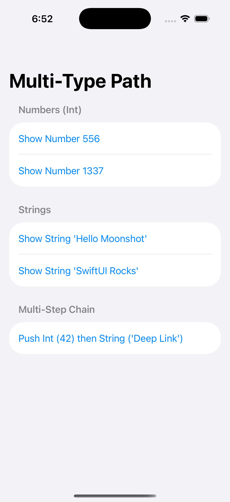

# Lesson 4: Navigating to Different Data Types using NavigationPath

In this lesson from Paul Hudson's **100 Days of SwiftUI** (Day 44 / Project 9), we move beyond homogeneous arrays (`[Int]`) and explore `NavigationPath`, a type-erased container capable of holding completely different data types on the same navigation stack.

---

## 📱 Screenshot

<p align="center">
  
</p>

---

## 🧩 Type-Erased Navigation with NavigationPath

Standard Swift arrays require all elements to be the same type (`[Int]` or `[String]`). 

In contrast, **`NavigationPath`** can accept any type conforming to `Hashable`:

```swift
@State private var path = NavigationPath()

// Push an Int:
path.append(42)

// Push a String onto the same stack:
path.append("Details")
```

Each type maps cleanly to its corresponding destination view using individual `.navigationDestination(for:)` modifiers:
```swift
.navigationDestination(for: Int.self) { number in
    IntegerDetailView(number: number)
}
.navigationDestination(for: String.self) { text in
    StringDetailView(text: text)
}
```
